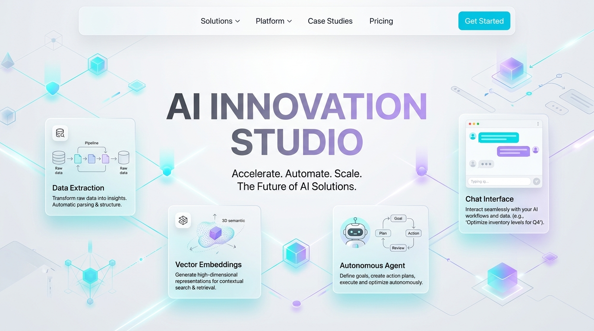
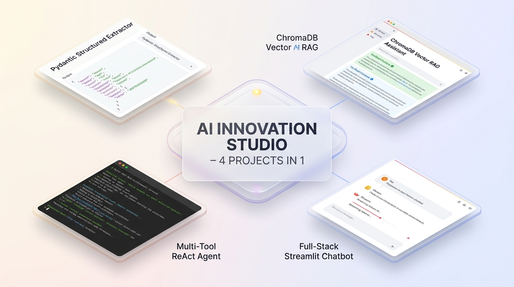
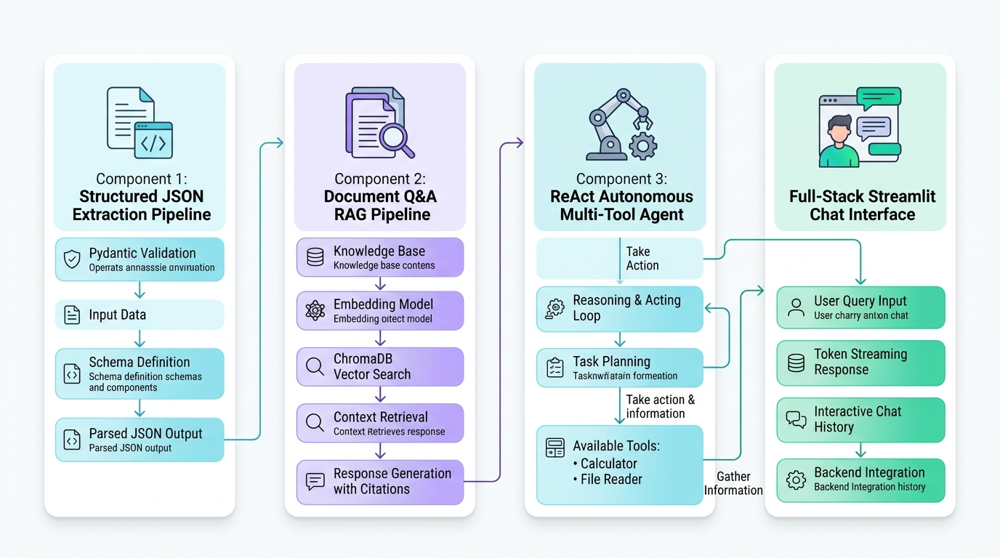

<p align="center">
  
</p>

<h1 align="center">AI Innovation Studio</h1>
<h3 align="center">Enterprise AI Engineering &amp; Autonomous Systems Portfolio</h3>

<p align="center">
  <a href="https://www.python.org/downloads/release/python-3120/"></a>
  <a href="https://docs.pydantic.dev/"></a>
  <a href="https://www.trychroma.com/"></a>
  <a href="https://streamlit.io/"></a>
  <a href="docs/test-report.md"></a>
  <a href="LICENSE"></a>
</p>

<p align="center">
  An enterprise-grade artificial intelligence software suite featuring four production-ready, independently executable applications. Designed for verifiable reliability, schema validation, grounded vector retrieval, sandboxed autonomous execution, and responsive conversational UI.
</p>

---

<p align="center">
  
</p>

---

## 🌟 The Four Core Applications

| Project | Domain | Architecture | Testing | Launch Command |
|---|---|---|---|---|
| **[Task 1: Structured JSON Extractor](task1-json-extraction/)** | Document Extraction | Pydantic v2, Few-Shot Prompts, Bounded Self-Correction | **9/9 Passed** | `streamlit run task1-json-extraction/app.py` |
| **[Task 2: Document RAG Assistant](task2-document-assistant/)** | Vector Search & Q&A | ChromaDB, Recursive Splitting, Verifiable Citations | **8/8 Passed** | `streamlit run task2-document-assistant/app.py` |
| **[Task 3: Multi-Tool Autonomous Agent](task3-autonomous-agent/)** | Autonomous Systems | ReAct State Loop, AST Math Engine, Sandboxed File IO | **8/8 Passed** | `python task3-autonomous-agent/main.py` |
| **[Task 4: Full-Stack AI Chatbot](task4-ai-chat/)** | Conversational UI | Token Streaming, `st.session_state`, Persona Steering | **6/6 Passed** | `streamlit run task4-ai-chat/app.py` |

---

## 🏗️ System & Pipeline Architecture

<p align="center">
  
</p>

```
+---------------------------------------------------------------------------------------------------------+
|                                        AI INNOVATION STUDIO                                             |
|                                       (Central index.html)                                              |
+--------------------+---------------------+-------------------------------+------------------------------+
                     |                     |                               |
                     v                     v                               v
+--------------------+   +-----------------+   +---------------------------+   +--------------------------+
| Task 1: Extractor  |   | Task 2: RAG Q&A |   | Task 3: Autonomous Agent  |   | Task 4: Streamlit Chat   |
| - Invoices & Resume|   | - PyPDF & TXT   |   | - DuckDuckGo Search       |   | - Session State          |
| - Pydantic v2      |   | - Text Splitter |   | - AST Math Engine         |   | - Token Streaming        |
| - Self-Correction  |   | - ChromaDB Store|   | - Sandboxed File Reader   |   | - Integrates T2 & T3     |
| - Streamlit UI     |   | - Citations UI  |   | - ReAct Audit Trace       |   | - Mode Selector UI       |
+--------------------+   +-----------------+   +---------------------------+   +--------------------------+
```

---

## 🚀 Deep-Dive Project Walkthroughs

### 📄 Task 1 — Structured LLM Prompt Pipeline & JSON Extractor
Converts unstructured business documents (commercial invoices and candidate resumes) into strictly typed, schema-validated JSON records.
- **Strict Pydantic v2 Validation**: Comprehensive type checking, non-negative numerical constraints, date parsing, and line-item mathematical cross-validation (`quantity * unit_price == total_price`).
- **Bounded Self-Correction Loop**: When invalid output or schema mismatches occur, diagnostics are routed back to the model (up to 2 retries) to repair malformed outputs.
- **Dual Cloud & Offline Parity**: Supports Google Gemini and OpenAI alongside an internal Deterministic Offline Engine for zero-token test runs.
- **Interactive Workspace**: Streamlit UI with PDF/TXT file upload, sample loaders, live JSON tree inspector, confidence scoring, and one-click JSON download.

### 🔍 Task 2 — Document Q&A Assistant with RAG & Vector Embeddings
Context-grounded question answering over PDF and TXT documents with verifiable page-level citations.
- **Document Ingestion**: Extracts text from `.pdf` (via `pypdf`) and `.txt` files while capturing page boundaries.
- **Semantic Text Chunking**: Configured with `RecursiveCharacterTextSplitter` (700-character chunks with 120-character semantic overlaps).
- **ChromaDB Vector Store**: Fast cosine similarity retrieval over dense embeddings.
- **Strict Anti-Hallucination Guardrails**: If retrieved context is insufficient or out-of-domain, the assistant returns an explicit refusal message:
  > *"I cannot find sufficient evidence in the uploaded documents to answer this question."*
- **Verifiable Citations**: Every claim specifies source filename, page number, similarity score, and verbatim excerpt.

### 🤖 Task 3 — Multi-Tool Autonomous AI Agent
A console-based autonomous agent executing the **ReAct (Reasoning + Action + Observation)** paradigm to solve compound, multi-step engineering tasks.
- **Pure AST Safe Calculator**: Evaluates arithmetic and scientific mathematical expressions via Python's `ast` module. **Zero `eval()`, zero `exec()`, zero code injection vulnerabilities**.
- **Sandboxed Local File Reader**: Reads files strictly limited to `./sandbox_data/`. Enforces canonical path boundary checks: rejects `..` traversal sequences, absolute paths, and symlink escapes.
- **DuckDuckGo Web Search**: Searches live technical documentation with query sanitization and offline knowledge cache fallback.
- **Auditable Trace Tables**: Rich terminal CLI (`main.py`) displaying step-by-step tool arguments, execution status, latency, and observation previews.

### 💬 Task 4 — Interactive Full-Stack AI Chatbot with Streamlit
A responsive conversational application with real-time token streaming and cross-pipeline integrations.
- **Streaming Chat UI**: Implements Streamlit's native `st.chat_message` and `st.chat_input` components with smooth token yields via asynchronous generators.
- **Session State History**: Preserves conversation history across user interactions via `st.session_state`.
- **Dynamic Persona Steering**: Pre-configured system personas: *General AI Assistant*, *Senior Code Reviewer*, *Technical Researcher*, and *Data & Systems Architect*.
- **Cross-Pipeline Integrations**: Toggle seamlessly between Direct Conversational Mode, Task 2 Document RAG, and Task 3 Multi-Tool Agent in a single UI!

---

## 🧪 Automated Test Verification (31/31 Passed)

Execute the full suite of automated unit tests across all four projects:

```bash
python launcher.py test
```

```text
================================================================================
  AI INNOVATION STUDIO — UNIFIED SYSTEM LAUNCHER
  Four Enterprise AI Internship Applications | Python 3.12
================================================================================

🧪 Executing Automated Test Suites Across All 4 Projects...

--- Running Task 1: Structured JSON Extractor (task1-json-extraction/tests/test_extraction.py) ---
9 passed in 0.10s [100%]

--- Running Task 2: Document RAG Assistant (task2-document-assistant/tests/test_rag.py) ---
8 passed in 2.94s [100%]

--- Running Task 3: Autonomous Multi-Tool Agent (task3-autonomous-agent/tests/test_agent.py) ---
8 passed in 1.93s [100%]

--- Running Task 4: Interactive Streamlit Chatbot (task4-ai-chat/tests/test_chat.py) ---
6 passed in 4.97s [100%]

================================================================================
🎉 ALL TEST SUITES PASSED (31/31 Unit Tests Succeeded)
================================================================================
```

---

## ⚡ Quickstart & Unified Launcher

```bash
# 1. Check environment dependencies
python launcher.py check

# 2. Run all 31 automated tests
python launcher.py test

# 3. Launch any application
python launcher.py run --task task1   # JSON Extractor
python launcher.py run --task task2   # Document RAG Assistant
python launcher.py run --task task3   # Autonomous Multi-Tool Agent
python launcher.py run --task task4   # Interactive Chatbot

# 4. Open the central landing portal
python launcher.py portal
```

---

## 📁 Repository Directory Structure

```text
vj/
├── index.html                           # Central Portfolio Portal (Dark Graphite + Violet/Cyan)
├── launcher.py                          # Unified CLI Launcher & Status Checker
├── linkedin.md                          # Ready-to-Publish LinkedIn Post & Narrative
├── linkedin_showcase.svg                # Standalone Light-Theme Vector Infographic
├── LICENSE                              # MIT Open Source License
├── README.md                            # Studio Overview, Architecture & Quickstart
├── .env.example                         # Environment Variable Template (Placeholders only)
├── .gitignore                           # Python, ChromaDB, Cache & Environment ignores
│
├── assets/                              # High-Resolution Light-Theme Visual Assets
│   ├── studio_hero_banner.jpg           # Technology Hero Banner
│   ├── studio_architecture_light.jpg    # Modular System Architecture Infographic
│   ├── linkedin_showcase.png            # 4-Projects-in-1 Showcase Mockup
│   └── linkedin_showcase.svg            # Scalable Vector Graphics Card
│
├── task1-json-extraction/               # Task 1: Structured JSON Extractor
│   ├── app.py                           # Streamlit Extraction Interface
│   ├── schemas.py                       # Pydantic v2 Invoice & Resume Schemas
│   ├── prompts.py                       # Parameterized Templates & Few-Shot Data
│   ├── extraction_service.py            # Extraction Engine with Bounded Self-Correction
│   ├── requirements.txt
│   ├── samples/                         # Test Invoices & Resumes
│   └── tests/                           # 9 Automated Unit Tests
│
├── task2-document-assistant/            # Task 2: Document RAG Assistant
│   ├── app.py                           # Streamlit Document Q&A Interface
│   ├── ingestion.py                     # Document Parsing & Recursive Splitter
│   ├── embeddings.py                    # Dual-Mode Dense Embeddings Engine
│   ├── retrieval.py                     # ChromaDB Vector Store & Citations Engine
│   ├── requirements.txt
│   ├── samples/                         # Enterprise Policy Documents
│   └── tests/                           # 8 Automated Unit Tests
│
├── task3-autonomous-agent/              # Task 3: Multi-Tool Autonomous Agent
│   ├── main.py                          # Interactive Rich CLI Runner
│   ├── agent.py                         # ReAct Autonomous Reasoning Engine
│   ├── tools/                           # Sandboxed Tools (Search, Math, File IO)
│   ├── sandbox_data/                    # Isolated Sandbox Repository
│   ├── requirements.txt
│   └── tests/                           # 8 Automated Unit Tests
│
├── task4-ai-chat/                       # Task 4: Full-Stack Streamlit Chatbot
│   ├── app.py                           # Streamlit Chatbot Interface
│   ├── chat_service.py                  # Token Streaming, Personas & Pipeline Bridges
│   ├── requirements.txt
│   └── tests/                           # 6 Automated Unit Tests
│
└── docs/                                # Technical Documentation
    ├── architecture.md                  # Comprehensive System Architecture
    ├── installation.md                  # Step-by-Step Execution Guide
    └── test-report.md                   # Automated Test Verification Matrix
```

---

## 📜 Documentation Links
- [System Architecture Specification](docs/architecture.md)
- [Installation & Execution Guide](docs/installation.md)
- [Automated Test Verification Report](docs/test-report.md)
- [LinkedIn Post & Visual Showcase](linkedin.md)

---

## 📄 License
This project is licensed under the [MIT License](LICENSE).
